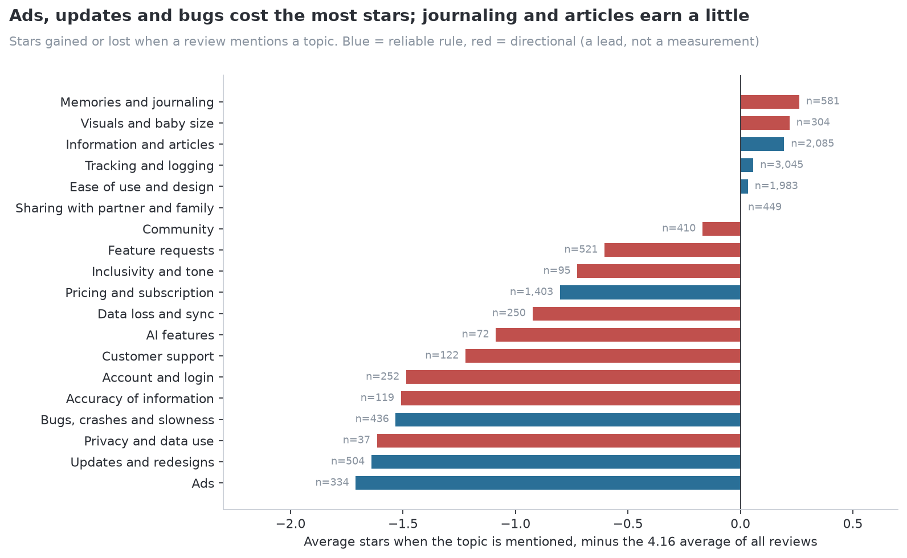
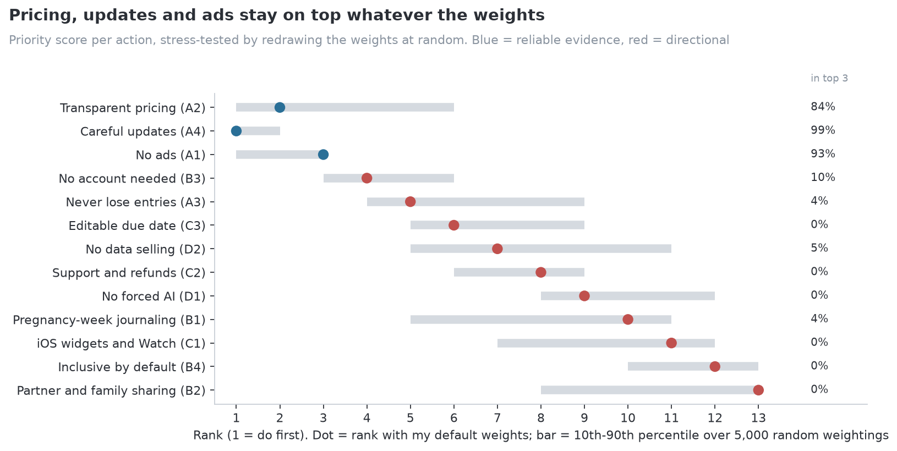

# Wombloom: using 7,955 app reviews to decide what to build first

I designed Wombloom, a private pregnancy and baby journal for iPhone, out of my own need during pregnancy. Before deciding what it should do first, I wanted evidence beyond my own experience. So I collected and analyzed App Store reviews of ten competing apps, built and validated a way to read what they are about, ranked the possible features, and checked my own plan against the result.

**Start here:** [the case study notebook](notebooks/wombloom_case_study.ipynb) · [interactive dashboard](dashboard/README.md) *(link after deployment)* · [full working notebook](notebooks/appendix_working_notebook.ipynb)

## The questions
1. What do parents praise and complain about in the apps they already use?
2. Where do existing apps leave a gap that a journal could fill?
3. What should Wombloom build first, and how sure can I be?

## What I found
- **Trust problems cost the most.** Reviews that mention ads, updates or bugs average 2.4 to 2.6 stars, against 4.16 overall.
- **Pricing is the most discussed pain point.** 20% of reviews mention it, and 36.5% of those are 1 or 2 stars.
- **Journaling is the clearest opening, but a thin one.** Reviews of journal-style apps talk about memories about 9 times as often as reviews of other apps, and mostly for two apps.
- **The top of the ranking is stable.** Pricing, updates and ads stay in the top three in 84% to 99% of 5,000 random weightings of the priority model.
- **My plan held up on trust and missed one thing.** Wombloom v1.0 has no ads, no account and collects no data, but entries live only on the phone.





## What I recommended
Do first: backup and export, a transparent pricing model, keeping the no-ads and no-account promises, and careful updates. Test before building: pregnancy-week prompts, a partner and family view, and inclusive defaults. Later: widgets and Apple Watch.

## How I approached it
- **I wrote the plan before collecting data** ([docs/research_plan.md](docs/research_plan.md)): scope, a repeatable way to choose competitors, privacy rules (no reviewer names or IDs) and a review checkpoint at each step.
- **I tested tools before trusting them.** An off-the-shelf sentiment model labeled only 44% of 1-2 star reviews as negative, so I used star ratings for direction and validated keyword topics for content. Topic rules were tuned on 100 labeled reviews and scored once on 50 held-out ones. Only the 7 of 19 topics that passed are treated as measurements.
- **Every comparison runs on two time windows.** Apple's feed gives the newest 500 reviews, which cover six months for one app and twelve years for another.
- **I stress-tested my own assumptions.** When the priority model ranked my favourite idea low, I kept the disagreement visible and added a second lens instead of tuning the model until it agreed.
- **I designed the measurement plan before launch,** within the app's "Data Not Collected" privacy promise.

**On AI:** I designed the question, the method and the decisions. I used an AI coding assistant (Claude Code) to write and run the code that carried out my plan, and I checked its output against ground truth and held-out data. The validation labels were made with AI assistance, which is the main limitation I would fix next.

## Repository

```
notebooks/
  wombloom_case_study.ipynb        the story: problem, method, findings, decisions, reflection
  appendix_working_notebook.ipynb  the full working record, every intermediate step
dashboard/                         Streamlit app (feature gap matrix, adjustable priorities, evidence)
src/
  discover_apps.py                 1. find and filter competitors (iTunes Search API)
  fetch_appstore_reviews.py        2. collect reviews (Apple customer-reviews feed)
  clean_and_load.py                3. clean, detect language, load into SQLite
  themes.py                        4. topic rules and their validation
  prioritize.py                    5. priority score and stress test
  build_aggregates.py              6. publishable aggregates for the notebook and dashboard
  report.py                        charts and tables for the case study
data/
  aggregates/                      counts, shares and averages (published)
  registers/                       action list, selected quotes, hand labels without text (published)
  measurement/                     launch post log template
docs/
  research_plan.md                 the plan written before data collection
  app_selection_log.md             how the 10 apps were chosen
  data_quality_report.md           what the data can and cannot support
  figures/                         every chart
```

Review text and the database stay local (`data/raw/`, `data/clean/`, `data/wombloom.db` are gitignored).

## Reproduce
```
python -m venv .venv
.venv\Scripts\activate            # macOS/Linux: source .venv/bin/activate
pip install -r requirements.txt

# Open notebooks/wombloom_case_study.ipynb in VS Code or Jupyter: it runs from data/aggregates, no collection needed
streamlit run dashboard/app.py

# Full pipeline from scratch (calls Apple's public endpoints, about 10 minutes):
python src/discover_apps.py
python src/fetch_appstore_reviews.py
python src/clean_and_load.py
python src/build_aggregates.py
```

## Limits
iOS only, US and Canada only, English only, recent reviews only. Reviewers are self-selected and describe other apps' users. The journal-app evidence rests mostly on one app, and 12 of 19 topics are leads rather than measurements.

**Tools:** Python, pandas, SQLite, scikit-learn, VADER, matplotlib, Altair, Streamlit, Jupyter.
