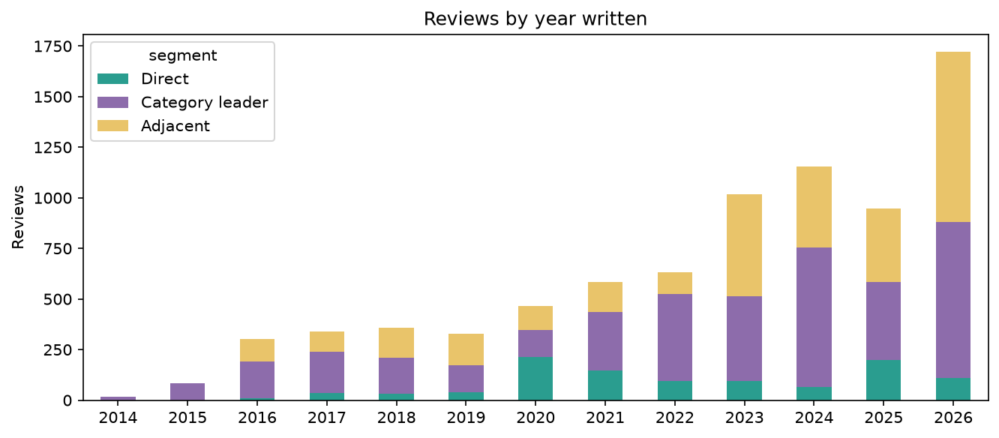
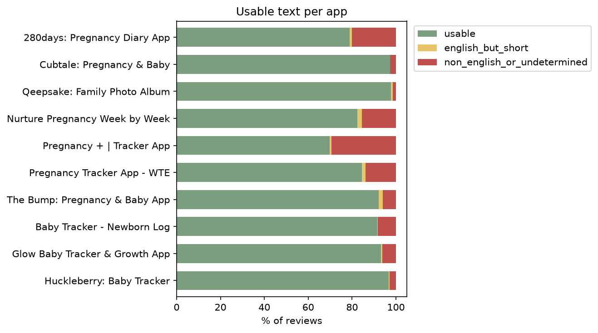
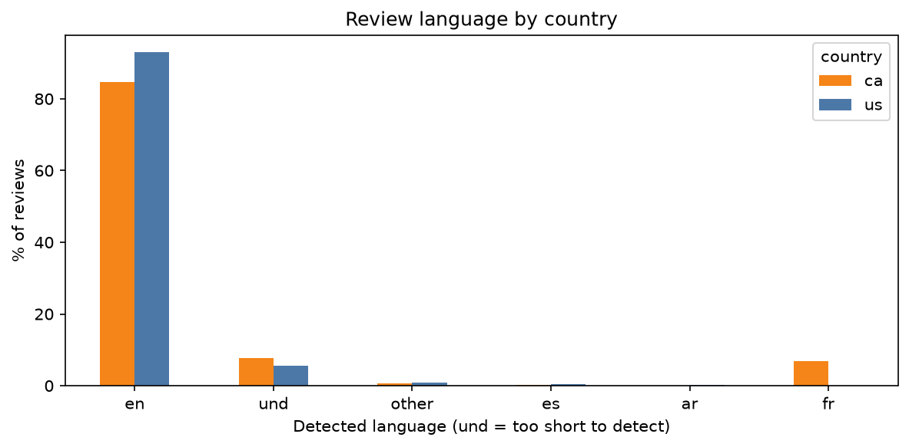

# Data Quality Report

Summary of the App Store review data collected for the Wombloom market research. The full analysis, with tables and charts, is in `notebooks/appendix_working_notebook.ipynb` (sections 8 to 10). This file is the short version.

## Dataset
- 7,955 reviews from 10 iOS apps in the US (4,426) and Canada (3,529), loaded in `data/wombloom.db` (tables `apps` and `reviews`).
- Date range: July 2014 to October 2026.
- Segments: Direct 1,036 reviews, Category leader 3,919, Adjacent 3,000.
- Platform: iOS only. Google Play was skipped (see `docs/research_plan.md`).

## Cleaning results
| Check | Result |
|---|---|
| Exact duplicates removed | 0 |
| Empty reviews | 0 |
| Very short (under 5 words), flagged | 627 (7.9%) |
| English | 7,105 (89.3%) |
| Non-English or undetermined, flagged | 850 |
| English with at least 5 words ("usable") | 7,024 (88.3%) |

Reviewer names, user IDs and profile URLs were dropped at ingestion. Original review text is kept untouched, and flagged reviews stay in the database.

## Reviews per app (US + CA)
| Segment | App | Reviews | Usable | Usable % |
|---|---|---|---|---|
| Direct | Qeepsake | 586 | 573 | 97.8 |
| Direct | Cubtale | 331 | 322 | 97.3 |
| Direct | 280days | 119 | 94 | 79.0 |
| Category leader | Pregnancy Tracker App - WTE | 1,000 | 844 | 84.4 |
| Category leader | Pregnancy + | 1,000 | 698 | 69.8 |
| Category leader | The Bump | 1,000 | 921 | 92.1 |
| Category leader | Nurture | 919 | 758 | 82.5 |
| Adjacent | Baby Tracker - Newborn Log | 1,000 | 916 | 91.6 |
| Adjacent | Huckleberry | 1,000 | 966 | 96.6 |
| Adjacent | Glow Baby | 1,000 | 932 | 93.2 |

## Charts
- 
- 
- 

## Known limitations and biases
1. **Recent reviews only.** The feed returns at most 500 reviews per app and country, newest first. Time windows range from about 6 months to almost 12 years, and 24.2% of reviews come from the last 12 months of the data.
2. **Self-selection.** Reviewers skew toward strong opinions, and ratings are heavily 5-star (58% to 90% by app). Apps that prompt users to rate, such as WTE (90% five-star), look better than they may be.
3. **iOS only.** Android users are not represented.
4. **US and Canada only.** Canada has more non-English reviews (15.4%) than the US (6.9%), mostly French.
5. **Small Direct sample.** 94 to 573 usable reviews per Direct app. The Canadian samples for 280days (14) and Cubtale (10) are too small to use alone.
6. **Language detection is approximate** on short text. 513 reviews are undetermined and treated as not usable.
7. **Selection method.** Apps were found by keyword search (top 200 results per query), so poorly ranking apps may be missing.
